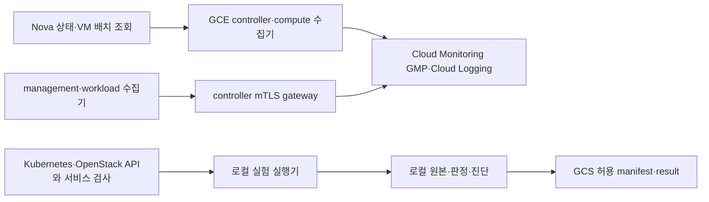

# 관측 운영과 증거 보존

GCP·OpenStack·Kubernetes의 상시 관측 배포·조회와 한계를 설명한다.
**2026-09-24에 정상 30분·전체 증감·Pod 실패 후 추적·수집기/gateway 중단·복귀를 검증했다.**
범위·예외는 [종합 검증](../docs/foundation-priority1-final-validation-2026-09-24.md),
초기 상태는 [최초 배포 기록](live-validation-2026-09-24.md)에 있다. 현재 클라우드 상태를 새로 확인한 기록은 아니다.

## 경로와 책임



GCE 수집기는 전용 서비스 계정으로 직접 전송한다. Nova guest에는 GCP 키를 배포하지 않고
클라이언트 인증서로 controller gateway에 전송한다. 자체 Kubernetes Workload Identity
Federation을 쓰는 구성은 아니다. Kolla의 Prometheus·Fluentd와 이 OTel 배포도 별개다.

실험 실행기는 현재 Kubernetes/OpenStack 상태와 서비스 능동 검사로 조치한다. GCP 조회는
조치의 전제 조건이 아니라 재현·감사·비교 근거다. 호스트 평균 사용률이나 VM 생성 성공만으로
특정 요청 지연의 원인·성능 여유를 확정하지 않는다. 시나리오별 판단 근거는
[S1~S4 실험 운영](../docs/graduation/experiments.md)을 따른다.

| 확인할 내용 | 코드 기준 |
|---|---|
| API·IAM·bucket·sink·보존 정책 | [gcp-setup.sh](gcp-setup.sh) |
| 호스트 설치·버전·로그 회전, 인증서 생성 | [host-install.sh](host-install.sh), [deploy-hosts.sh](deploy-hosts.sh) |
| 호스트 지표·Kolla 로그·gateway·큐 | [controller 설정](host-collector.yaml.tpl), [compute 설정](compute-collector.yaml.tpl) |
| Nova 서비스·VM 상태·배치와 조회 주기 | [openstack-inventory.py](openstack-inventory.py), [timer](openstack-inventory.timer) |
| node·Pod·container·volume 지표와 로그 | [management agent](k8s-agent-config.yaml.tpl), [workload agent](k8s-workload-agent-config.yaml.tpl) |
| Node·Pod 상태·Events, 배치·권한·heartbeat | [cluster 설정](k8s-cluster-config.yaml.tpl), [매니페스트](k8s-collectors.yaml), [설치·CA 검사](deploy-clusters.sh) |
| 식별자·관측 수명·누락 판정·업로드 허용 목록 | [manifest 생성](build-run-manifest.py), [검증기](verify-live.py), [publish](publish-run.sh) |

실행 ID·단계별 UTC·Pod/Node/Machine/Nova UID·compute 배치를 연결한다. 고정 호스트 지표에
매 실행 ID를 붙이지 않고 manifest의 시간 구간으로 조회한다. 명령 요청과 실제 상태 확인,
값 0과 측정 불가, 실행 성공과 증거 완전성을 구분한다. heartbeat·Nova 로그는 원래 발생 시각을 보존한다.

## 설치·조회 순서

실제 배포와 같은 `ENV_OVERRIDE_FILE`을 선택한다. 최초 GCP setup은 세 호스트가 모두
중지되어 있어야 하며 기존의 다른 서비스 계정이 붙어 있으면 거부한다. Logging·Monitoring
전용 쓰기 권한과 증거 bucket 범위의 objectCreator를 부여한다. 공개 bucket을 만들지 않는다.
`CONFIRM`은 선택한 환경 이름이며 아래는 기본 환경 예시다.

```bash
make observability-gcp-status
make observability-gcp-setup CONFIRM=cloud-gcp-amd64
make gcp-start
make gcp-openstack-recover
make observability-workload-guests-start
make observability-hosts-install
make observability-clusters-install
make observability-hosts-status
make observability-clusters-status
make observability-verify
make observability-gcp-dedupe CONFIRM=cloud-gcp-amd64
```

`gcp-openstack-recover`는 Nova guest를 시작하지 않으므로 별도 guest 시작 단계가 필요하다.
클러스터 설치는 선택 프로필의 CA와 gateway에 설치된 CA의 SHA-256이 다르면 변경 전에
중단한다. 같은 프로필로 호스트 설치부터 수행한다. 전용 로그 bucket의 유입을 검증한 뒤
`dedupe`로 해당 로그 ID만 `_Default` sink에서 제외한다. GCE 자동 STOP 정책은 유지한다.

조회는 [Metrics Explorer](https://console.cloud.google.com/monitoring/metrics-explorer)에서
`prometheus.googleapis.com/*`의 `system_*`·`k8s_*`를, [Logs Explorer](https://console.cloud.google.com/logs/query)에서
선택 project의 `osk8s-observability` bucket과 `log_id("osk8s-otel")`를 사용한다.
`make observability-verify`는 환경의 project·region·호스트 클러스터를 전달한다. 검증기를 직접
호출할 때는 이 인자를 실제 환경에 맞춰 지정한다. 전체 옵션은 `python3 observability/verify-live.py --help`로 확인한다.

검증기는 대상별 시계열·heartbeat·Nova 상태의 양끝과 중간 공백을 검사한다.
`--start`·`--end`로 UTC 구간, `--max-gap-seconds`로 허용 공백을 지정한다.
`--expected-targets <JSON>`의 `targets` 배열에 `cluster`, `instance`, 선택적
`start_utc`·`end_utc`를 넣으면 한 번도 보고하지 못한 노드도 검사한다.
삭제된 worker는 `--manifest <schema v2 manifest>`로 관측 수명을 지정한다.
기대 대상 없이 하는 조회는 모든 동적 노드의 완전한 수집을 보장하지 않는다.
다른 노드의 최신 표본으로 누락을 가리지 않으며 조용한 Events·앱 로그 자체는 장애로 판정하지 않는다.

자동 증감 실행 후 `make observability-publish-run RUN_DIR=/absolute/path/to/autoscaler-cycle-...`로
허용된 manifest·result만 GCS에 보낸다. 과거 실행은 `observability/build-run-manifest.py <run-dir>`로
인덱싱할 수 있다. 이미 만든 manifest는 덮어쓰지 않으며 v2는 단계 snapshot·UID·최초/최종 시각과
짧게 존재한 probe Pod를 보존한다. 졸업작품의 전체 요청 원본·진단은 로컬 `artifacts/`에 남는다.

## 장애 해석과 남은 범위

- 큐와 재시도는 유한하다. exporter의 표본 순서와 gateway가 표본을 다시 묶지 않는 설정을 유지하고,
  전송 실패·수신 거부·큐 포화·영구 드롭·복귀 공백을 기록한다. 삭제된 VM의 미전송 큐 복원을 가정하지 않는다.
- controller 중단 시 guest의 GCP 전송이 멈춘다. compute 수집기는 직접 전송하지만 controller는
  OpenStack·management 제어 경로이기도 하므로 실험 대응의 지속을 보장하지 않는다.
- 실행기·HTTP 검사기는 로컬 작업 컴퓨터에 있다. 절전·터널·API 오류의 공백과 서비스 장애,
  계획된 GCE STOP과 예기치 않은 중단을 구분한다. 시간 상한·소유 자원 정리는 [운영 가이드](../docs/operations.md)를 따른다.
- 관측 수용 시험은 정상 구간, 전체 증감과 삭제 노드 추적, Pod 실패, 수집기/gateway 중단·복귀를 포함한다.
  이후 S1~S4 성공이 각 실행의 GCP telemetry 전체 경로 수용까지 뜻하지는 않는다.
- Grafana·CAPI/CA 내부 reconcile 메트릭은 미구현이다. CA/CAPI의 Pod 상태·Events·로그는 수집한다.
  일반 고객 Ingress·HTTP 연속성·성능·격리는 [기반 우선순위](../docs/product/infrastructure-priorities.md)의 별도 범위다.

CA·키는 `.state/<environment>/secrets/observability/`에 두고 Git에 넣지 않는다.
서버·클라이언트 인증서는 365일 후 갱신이 필요하다. kubelet TLS 서버 검증 생략을 CA 검증으로
교체하고 인증서 갱신 후 전송 복귀를 확인해야 한다. 로그 가림 processor가 임의 고객 로그의
모든 비밀을 제거한다고 보장하지 않으며 고객별 수집·권한·보존·삭제·격리 정책은 별도로 정해야 한다.

현재 Cloud Logging 검색 보존은 30일, GCS 자동 삭제는 없으며 호스트 JSONL은 일 단위 7개를
유지한다. 관리형 지표 보존은 서비스 정책을 따른다. 수집기 자원·비용·실험 영향의 측정과
[최종 평가의 API·DNS·Neutron 후속 과제](../docs/graduation/final-evaluation-results-2026-10-03.md)는 남아 있다.
물리 서버 이전 시에는 별도 관리망·저장소·인증·백업·장애 감지 경로를 새 ADR과 실측으로 검증한다.
